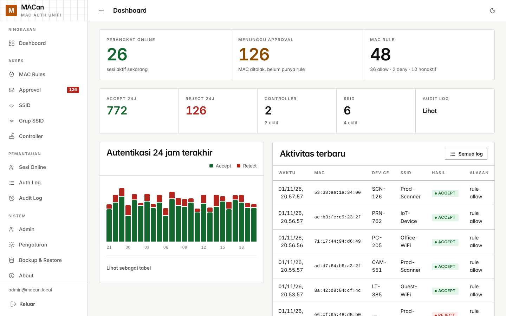
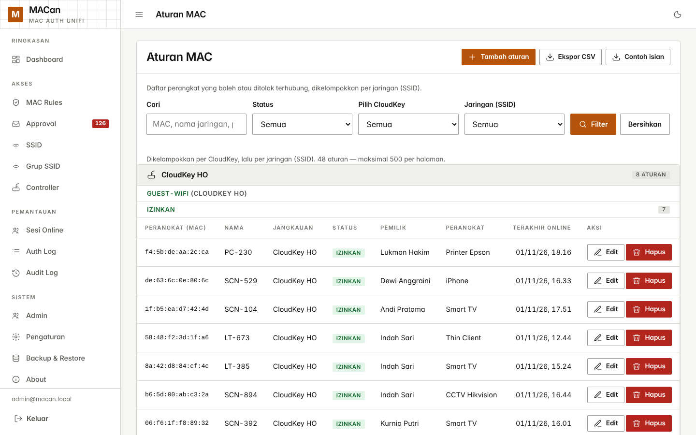
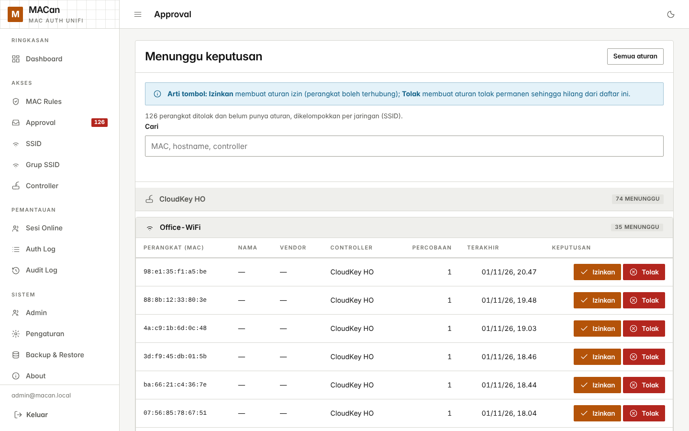
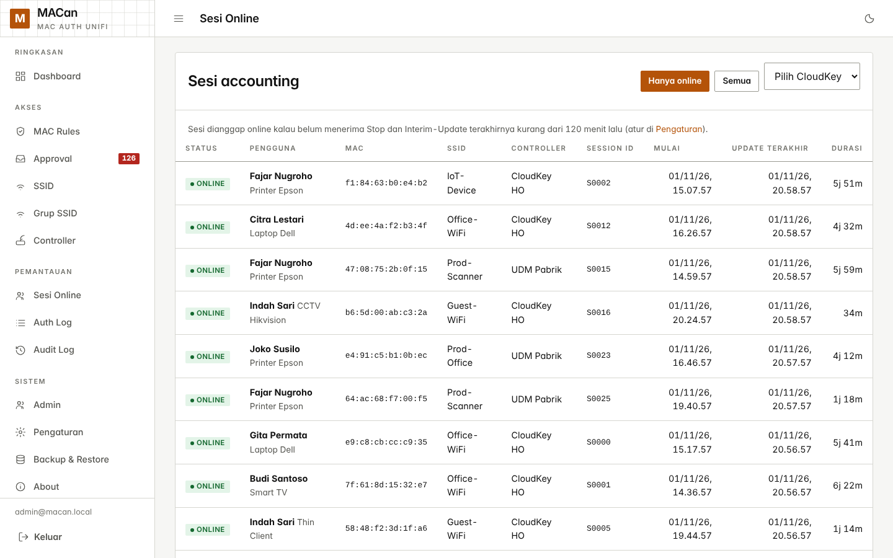
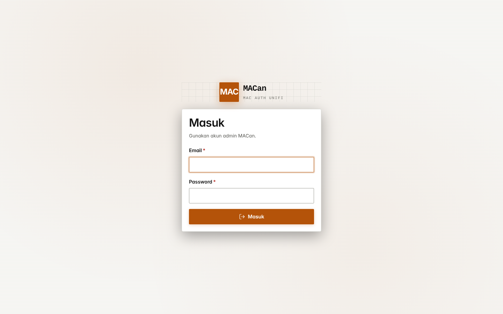

<div align="center">

# MACan

**English** · [Bahasa Indonesia](README.id.md)

**MAC authentication for UniFi over RADIUS, with no 802.1X and no captive portal.**

Register device MAC addresses, decide per SSID whether each one may connect, and let UniFi ask MACan every time a device tries to join.

[](https://freeradius.org)
[](https://mariadb.org)
[](https://nodejs.org)
[](https://docs.docker.com/compose/)


</div>

## Contents

- [Why MACan](#why-macan)
- [Interface](#interface)
- [Quick start](#quick-start)
- [Updating](#updating)
- [Connecting UniFi](#connecting-unifi)
- [How decisions are made](#how-decisions-are-made)
- [Features](#features)
- [UniFi API integration](#unifi-api-integration)
- [Security](#security)
- [Project layout](#project-layout)
- [Development](#development)
- [License](#license)

## Why MACan

UniFi supports RADIUS MAC authentication but gives you nowhere to manage the MAC list. MACan fills that gap with one web panel for MACs, SSIDs, and controllers, plus an audit trail of every authentication decision.

- Devices that cannot do 802.1X, such as IoT sensors, printers, attendance terminals, and CCTV, can still be authenticated without certificates or a supplicant.
- Rules apply per SSID. The same MAC can be allowed on `Office-WiFi` and blocked on `Guest-WiFi`.
- The system fails closed. An unknown controller, an SSID that has not been enabled, or active maintenance mode always results in a reject.
- Accepts and rejects are both logged with a reason, so every decision can be traced.

## Interface



*Dashboard with the 24-hour accept/reject chart*

| | |
|:---:|:---:|
| <br/>MAC rules grouped by CloudKey and SSID | <br/>Approval queue |
| <br/>Online sessions from RADIUS accounting | <br/>Sign-in |

Captured from a local instance with generated demo data; names and MAC addresses are fictitious.

## Quick start

You only need Docker and Docker Compose. Node and MariaDB do not have to be installed on the host.

```bash
git clone https://github.com/torpedoliar/MACAN.git
cd MACAN
./setup.sh
```

`setup.sh` checks Docker, then runs a four-step wizard:

1. Database: `DB_PASSWORD` and `DB_ROOT_PASSWORD` are generated at random without prompting, because they are only used between containers.
2. Session key: `SESSION_SECRET` is generated at random (32 bytes).
3. First admin: you enter an email and a password. The password is typed twice, never echoed, and must be at least 8 characters.
4. Panel access: the "Use HTTPS?" question sets `COOKIE_SECURE`. The default is `n`, which is safe for plain HTTP.

The script then writes `.env` with mode `600`, builds the stack, and waits for the panel to respond before printing the URL and next steps.

It is safe to run again. Values that are already set are neither asked for nor overwritten; the wizard only asks for what is still empty. Without a terminal (for example through a pipe or CI), the script still generates the three secrets, then stops and lists the values you must fill in by hand.

<details>
<summary>Manual setup</summary>

```bash
cp .env.example .env
# edit .env and replace every "change-..." value
docker compose up -d --build
```

| Variable | Value |
|---|---|
| `DB_PASSWORD` | password for the `macan` database user |
| `DB_ROOT_PASSWORD` | MariaDB root password |
| `SESSION_SECRET` | a long random string, for example from `openssl rand -hex 32` |
| `ADMIN_EMAIL` | login email of the first admin |
| `ADMIN_PASSWORD` | password of the first admin |
| `COOKIE_SECURE` | `0` for HTTP, `1` only behind HTTPS |

Docker Compose interpolates `.env`, so a `$` inside a password must be written as `$$`. Otherwise `Pa$word` reaches the container as `Pa`. `setup.sh` escapes this for you.

</details>

Open `http://<server-ip>:880` and log in with `ADMIN_EMAIL` / `ADMIN_PASSWORD`. The database schema and the first admin are created automatically on first boot.

| Port | Protocol | Purpose |
|---|---|---|
| `880` | tcp | web panel |
| `1812` | udp | RADIUS authentication |
| `1813` | udp | RADIUS accounting |

> `COOKIE_SECURE=1` over plain HTTP means the session cookie is never sent, so login fails without an error message. Keep it at `0` until HTTPS is actually in place.

`GET /health` (no login) returns `{"status":"ok"}` when the database is reachable and `503` when it is not. `setup.sh` uses it, and it works well for uptime monitoring.

### Forgotten admin password

```bash
bash reset-admin-password.sh
```

The script asks for the admin email, reads the database credentials from `.env`, and resets that account to the default password written in the script. Because the default is in the repository, change it right after logging in. Override the database container name with the `CONTAINER` variable if needed.

## Updating

```bash
./update.sh
```

Five steps, stopping at the first one that fails:

1. Back up the database to `backups/macan_<date>.sql` with `mariadb-dump --single-transaction`. The dump is consistent without locking tables, so RADIUS keeps answering during the backup. If the backup fails, the update is cancelled and nothing changes.
2. `git pull --ff-only origin main`. If this fails because of local changes, the containers are still on the old version and nothing is broken.
3. Build the `web` and `radius` images. `radius` has to be rebuilt because its configuration is copied into the image; a restart alone does not load changes.
4. Recreate the `web` and `radius` containers with `--no-deps`.
5. Wait for `/health` to return 200. Migrations run when `web` starts, so this step also confirms the schema is up to date.

The `db` container is never stopped, rebuilt, or removed. `down` and `down -v` are never called, so the `db_data` volume is never touched. The ten most recent backups are kept and older ones are deleted.

To roll back to the data from before an update:

```bash
docker exec -i $(docker compose ps --format '{{.Name}}' db) \
  sh -c 'exec mariadb -uroot -p"$MARIADB_ROOT_PASSWORD" macan' \
  < backups/macan_<date>.sql
```

> Files in `backups/` contain RADIUS shared secrets, UniFi credentials, and Telegram tokens. The folder is in `.gitignore`; do not copy it anywhere with looser permissions.

## Connecting UniFi

### 1. Add the controller in MACan

Go to Controller → Tambah and enter a name, the source IP of the RADIUS packets, and the shared secret.

The device that sends RADIUS packets is not always the controller. In UniFi, access points usually contact RADIUS directly, so the source IP is the AP's address. The IP field therefore accepts two forms:

| Value | When to use it |
|---|---|
| `10.10.0.100` | a single host sends the packets (for example a controller relaying RADIUS) |
| `10.10.0.0/24` | every AP in a subnet sends packets directly |

A host entry takes priority over a subnet entry that contains it, so one AP can have its own entry without affecting the subnet entry. Accepted prefixes are `/8` to `/32`. The shared secret applies to the whole registered subnet, so keep subnets as narrow as possible.

Controller changes do not need a restart. FreeRADIUS looks up unknown source IPs in the `controllers` table on each packet (`radius/macan_clients.conf`) and caches the result for 5 minutes. A new controller works on its first packet; changing the IP or shared secret, disabling, or deleting a controller takes effect within 5 minutes. To clear the cache immediately, run this inside the radius container: `radmin -e "del client ipaddr <ip>"`.

### 2. Create a RADIUS profile in UniFi

Settings → Profiles → RADIUS → Create New:

| Field | Value |
|---|---|
| Auth Server | MACan server IP |
| Auth Port | `1812` |
| Auth Secret | the same shared secret as in MACan |
| Accounting Server | MACan server IP |
| Accounting Port | `1813` |
| Accounting | enabled |

### 3. Enable MAC authentication on the WiFi network

Settings → WiFi → \<SSID\> → Advanced → MAC Authentication, then select the RADIUS profile.

### 4. Enable the SSID in MACan

The first packet from UniFi makes the SSID appear automatically under SSID with a disabled status. This is deliberate: an operator has to enable it before any MAC can get through.

## How decisions are made

Each Access-Request is evaluated in order and stops at the first match.

```
Access-Request
      │
      ├─ Calling-Station-Id is not 12 hex digits?   → REJECT  invalid MAC
      ├─ sender IP not in controllers?              → REJECT  unknown controller
      ├─ maintenance_mode = 1?                      → REJECT  maintenance mode
      ├─ SSID not enabled by an operator?           → REJECT  SSID disabled
      │
      └─ look up a rule (controller scope first, then global)
              ├─ allow     → ACCEPT
              ├─ deny      → REJECT  deny rule
              ├─ disabled  → REJECT  rule disabled
              └─ none      → REJECT  no rule found  ← shown in Approval
```

MACs are normalized first, so these four formats are treated as the same address:

```
aa:bb:cc:dd:ee:ff    aabbccddeeff    aa-bb-cc-dd-ee-ff    aabb.ccdd.eeff
```

A rule is either global (all controllers) or scoped to one controller. When both match, the controller-scoped rule wins.

## Features

### Access

- MAC Rules: create, edit, and delete rules with status `allow`, `deny`, or `disabled`, plus owner, device name, hostname, and note fields. Search accepts MACs with or without colons. The page is grouped per SSID, with allow rules expanded and deny or disabled rules collapsed. The new and edit forms offer an SSID dropdown taken from the inventory.
- Approval: MACs rejected because they have no rule are collected on one page, grouped per SSID, with search and pagination. One click turns an entry into an allow rule. The page is based on the absence of a rule, not on the reject message text, so it keeps working if policy messages change.
- SSID: unknown SSIDs appear automatically on their first packet, disabled.
- SSID groups: several SSIDs can be combined into a group, and one group rule then applies to every member. A group rule is stored as one `mac_rules` row per member, so the FreeRADIUS lookup stays a single `SELECT` per MAC and SSID pair. Groups can be renamed and their members changed; member rules are re-synced automatically.
- Controller: the list of NAS clients with shared secret, host or subnet IP, and optional UniFi credentials. Duplicate IPs are refused, and so is deleting a controller that is still referenced by an SSID, rule, or log entry.
- Multiple CloudKeys: the Rules, Approval, and Sessions pages can be filtered per controller, so one MACan instance can serve several CloudKeys or UDMs.

### Monitoring

- Online sessions: built from accounting packets and showing who is connected. Owner and device names come from the matching MAC rule (controller scope before global, in the same order as `default.conf`). Sessions without a rule are labeled as such. `Accounting-On`/`Off` from a rebooting controller closes all of its sessions, and a cron job ends sessions that stop receiving updates.
- Auth Log: accepts and rejects with reasons, filterable, including the raw packet attributes as JSON.
- Audit Log: who changed what, and when. Secret values such as bot tokens are never written here.
- Device vendor: the IEEE OUI table (about 35,000 prefixes) is downloaded from the `linuxnet.ca` mirror and refreshed automatically on the 1st of each month at 03:07, so the panel can show the vendor of every MAC.

### Automation

- Inactivity audit: `allow` rules that have not connected for `inactive_after_days` (default 90, configurable in Settings) are switched to `deny` and marked Inactive. The marker is a separate column (`inactive_since`), not a fourth status, because FreeRADIUS only understands `allow`/`deny`/`disabled`; any other value would read as "no rule found" and the MAC would reappear in Approval. The sweep checks two timestamps, last connection and last admin edit, so a rule that was just re-allowed is not flipped back on the next run. An Inactive filter is available on the MAC Rules page.
- Notifications: Telegram and/or a generic webhook for reject spikes from one MAC, newly detected SSIDs, and MACs waiting for approval. Time-based deduplication prevents floods.
- Housekeeping: an hourly cron (at minute 7) prunes logs past their retention period, closes stale sessions, runs the inactivity sweep, and sends pending notifications.

### System

- Admins: one account per person, each with its own login. Clearing the Active flag blocks login immediately while keeping the history. Accounts can also be deleted; their Audit Log rows remain and show as "deleted admin". Two guards apply: you cannot delete or deactivate your own account, and the last active admin cannot be deleted or deactivated.
- CSV import and export with the columns `scope,controller,ssid,mac,status,owner,device,note`. Rows with problems are reported by line number while the other rows are still imported. A sample file can be downloaded from the MAC Rules page.
- Backup and restore: download all data as JSON. Restore takes three steps: upload, preview the contents, then confirm by typing `GANTI`. Backups from a different installation are refused.
- Maintenance mode: one click rejects all new authentications and makes the panel refuse data changes with HTTP 503. Existing sessions are not affected because they do not re-authenticate.
- An About page lists the developer and the repository URL.

## UniFi API integration

Each controller can be given UniFi credentials so MACan can pull device hostnames from UniFi Network:

- `unifi_host`, `unifi_site`, and `unifi_api_key` for the UniFi Network Integration API (`/proxy/network/integration/v1`, `X-API-KEY` header). Self-signed certificates are accepted only when TLS verification is turned off for that controller.
- `unifi_username` and `unifi_password` for the classic API. MACan tries both the UDM login path (`/api/auth/login`) and the CloudKey path (`/api/login`), so hostnames of clients that are currently offline are synced as well.
- A connection test button checks the classic API login with the entered username and password.
- Hostnames for all UniFi clients are synced and shown in the Hostname column on the Rules and Approval pages. Fetching follows UniFi's server-side page limit of 200 clients.

## Security

- Admin passwords are hashed with bcrypt. No password is stored in plain text.
- Sessions are stored in the database rather than in memory, so a restart does not log everyone out.
- Every form uses a CSRF token. Upload routes verify it after multer has parsed the body, and `self-check` contains an assertion that fails the build if a new upload route forgets to do so.
- Every query uses parameter binding; no SQL is built from strings.
- Notification tokens are never sent back to the page and never written to the audit log.
- `.env` is in `.gitignore`. Replace every default value before using MACan on a production network.

> The RADIUS shared secret travels over the network in a cryptographically weak form. Run MACan on a management VLAN, not on a network that WiFi clients can reach. For panel access from outside, put it behind an HTTPS reverse proxy and set `COOKIE_SECURE=1`.

## Project layout

```
compose.yaml              three services: db, web, radius
setup.sh                  bootstrap: check docker, .env wizard, generate secrets, up
update.sh                 update: back up db, git pull, rebuild web+radius, wait for /health
reset-admin-password.sh   reset an admin password through the MariaDB container
db/schema.sql             initial schema, run by MariaDB on first boot
radius/
  Dockerfile              FreeRADIUS plus the config files below
  default.conf            authorize and accounting policy (the decision logic)
  sql.conf                database connection, read_clients from the controllers table
  queries.conf            client/NAS queries
  macan_clients.conf      per-packet dynamic controller lookup
web/
  Dockerfile              node:20-alpine
  public/                 app.css (design tokens, dark mode) and app.js (vanilla JS)
  src/
    app.js                Express shell: views, middleware, route mounting
    migrate.js            idempotent migrations, run on every start
    middleware.js         MySQL session store, CSRF, maintenance guard, error handler
    radius-policy.js      MAC normalization, shared with routes
    pending.js            definition of "waiting for approval"
    ssid-groups.js        expansion of group rules to member SSIDs
    unifi.js              UniFi Integration API and classic API client
    oui.js                IEEE OUI vendor table
    db.js  auth.js  audit.js  notifications.js  cron.js  logo.js
    routes/               13 route modules
    views/                EJS templates
  test/self-check.js      compiles and renders every view, with and without data
```

The architecture is deliberately thin: no frontend framework, no build step, no ORM. `docker compose up` is enough to run everything.

## Development

```bash
cd web
npm install
npm run self-check     # compile and render every view, with and without data
npm start              # needs MariaDB; compose is easier
```

The files in `radius/` are copied into the image, so after changing them a restart is not enough:

```bash
docker compose up -d --build radius
```

Test a decision without a real device:

```bash
docker compose exec radius sh -c 'printf "User-Name=aa:bb:cc:dd:ee:ff\n\
Calling-Station-Id=aa:bb:cc:dd:ee:ff\n\
Called-Station-Id=aa:bb:cc:dd:ee:ff:Office-WiFi\n" \
  | radclient -x 127.0.0.1:1812 auth <shared-secret>'
```

Check the FreeRADIUS configuration: `docker compose exec radius freeradius -XC`

> Inside `radius/default.conf`, an unbalanced curly brace closes a `%{sql:...}` expansion early and truncates the query. Avoid quantifiers such as `{12}` in regular expressions, including inside comments.

## License

Released under the [MIT License](LICENSE). Copyright © 2026 torpedoliar.

Developed by Yohanes Octavian Rizky ([@torpedoliar](https://github.com/torpedoliar)).
